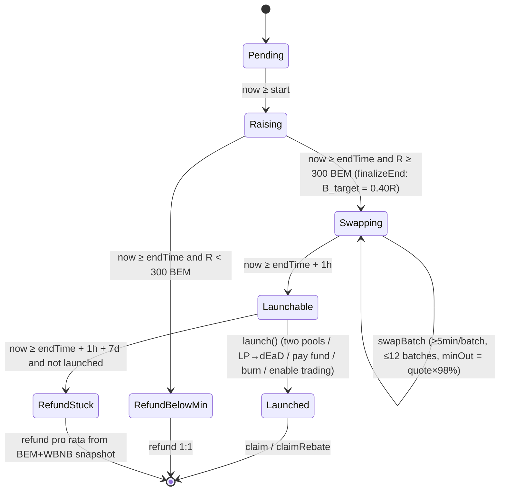

# tapecat smart-contract design (development / audit)

> Version: contract design v1.3 (based on [plan.md](plan.md) v0.11) · 2026-10-19 (UTC+8)
> Chain: BNB Smart Chain (chainId 56) · Solidity ^0.8.24 · OpenZeppelin v5.x
> Status: design draft, **not production code**. Fill and re-check every address and timestamp in §12 before deploy.

---

## Changelog

### v1.3 (2026-10-19) relative to v1.2

| # | Change |
|---|---|
| 1 | **`MIN_RAISE = 300e8` (300 BEM).** After `endTime`, `R < MIN_RAISE` is still `RefundBelowMin`. `refund()` returns all BEM. No swap, no launch. The per-address cap is still 1.5 BEM, so at least 200 full-cap addresses are required to clear the floor. The Sale bytecode already deployed on mainnet is still 10 BEM. This takes effect on the next deploy. |

### v1.2 (2026-10-18 19:31 UTC+8) relative to v1.1

| # | Change |
|---|---|
| 1 | **Adopted implementation shape**: flat `contribute(amount, referrer, xIdHash, cap, deadline, sig)`. TYPEHASH uses `cap` and **no nonce**. Suggested signature lifetime **30–60 minutes** (verifier default 1800s). |
| 2 | **Adopted**: `Config` struct plus `v3Factory` derives the three reference pools; `phase()` / `claimableTokens()` / implementation error names; donations capped pro rata (no skim of synced reserves); partial fills use a pro-rata `minOut`, and `spent ≥ 99.9%·amount`. |
| 3 | **Minimum batch**: `amount ≥ ceil(remaining / batchesLeft)`, so dust batches cannot burn the 12-batch budget. Pairs with FILL_BPS. |
| 4 | **Threat model correction**: worst loss on one batch ≈ **2% slippage + ~2% TWAP tolerance ≈ 4–5%** (not “≤2%”). `TWAP_WINDOW = 120s < BATCH_CD = 300s`. |
| 5 | **P2**: `cap ∈ {1e8, 1.5e8}`; referrer bound only on the first contribution; `setTaxReceiver` rejects pair/Sale/token/0; BEM decimals == 8; launch dust swept to the fund; `Launched` emits `pricePerMillionX8 = 2R/600`. |
| 6 | Public `/api/keeper/plan` **returns Direct only**. Gelato simulation must set `from = keeperAddress`. |

### v1.1 (2026-10-18 19:09 UTC+8) relative to v1.0

### v1.0 (2026-10-18)

- First draft, from plan v0.8.

---

## 0. Summary and notation

| Item | Contents |
|---|---|
| Goal | Raise BEM → within 1 hour, swap 40%·R of that BEM to WBNB in batches → create tapecat/BEM and tapecat/WBNB PancakeSwap V2 pools at “2× participant cost” (LP → dEaD) → participants claim 100% at once |
| Use of funds (R = BEM actually raised) | 40%·R into the tapecat/BEM pool; 40%·R swapped to WBNB into the tapecat/WBNB pool (unsold BEM joins the BEM pool); 10%·R to the project-fund Safe; 10%·R for referral rebates |
| Token | Fixed supply 1,000,000,000 tapecat (18 decimals). No mint, no blacklist, no pause. A fixed 1% tax on the two launch pairs only |
| Decentralization | Raise, swap, pool creation, claim, and refund are permissionless with parameters hard-coded. The centralized pieces are: the allocation signer (off-chain X task checks), four addresses the Safe can change (`signer` / `officialReferrer` / `fundWallet` before launch / `taxReceiver`), and the keeper allowlist the Safe manages (aggregator swap routes only; the direct route, `launch`, refund, and the rest stay permissionless) |

**Notation**

| Symbol | Meaning | Unit / precision |
|---|---|---|
| `R` | `totalRaised`, BEM raised (accounted by balance delta) | BEM base units (1 BEM = 1e8) |
| `S` | Total supply 1e9·1e18 | tapecat wei |
| `T_P` | Participant share 600,000,000e18 | tapecat wei |
| `B_target` | Planned swap size = `R·4000/10000` | BEM units |
| `bemSold` / `wbnbReceived` | BEM actually sold / WBNB actually received (balance-delta sums) | BEM units / WBNB wei |
| `c` | Participant average cost = `R / T_P` (BEM/tapecat) | — |
| `p` | Opening price = `2c = 2R / T_P` | — |
| `r_exec` | Realized swap price = `wbnbReceived / bemSold` (WBNB/BEM) | — |
| `bps` | Basis points, 10000 = 100% | — |

**Relative to plan v0.10 / the implementation freeze**: flat contribute (no nonce); `Config` + factory-derived pools; three-pool TWAP (120s, ±200 tick); minimum batch + 99.9% fill; keeper allowlist; `phase` / `claimableTokens`; donations capped pro rata; rebate dust swept to the fund.

---

## 1. Scope, contracts, deploy order, constructor arguments

### 1.1 Contracts and libraries

| Contract / library | Kind | Role | Upgradeable |
|---|---|---|---|
| `TapecatToken` | ERC20 (OZ) | Fixed supply; transfers locked before launch; 1% fixed LP tax; `setTaxReceiver` | No (no proxy) |
| `TapecatSale` (the launcher) | EIP712 + ReentrancyGuard | Raise, X-account binding, rebate accounting, 1h batched swap, pools, fund payment, burn, claim, refund, Safe admin | No (no proxy) |
| `SaleMath` (internal library, optional) | library | Pricing / share / budget-cap formulas (for unit tests and fuzz) | — |
| `QuoteLib` (internal library, optional) | library | QuoterV2 quotes (try/catch, take the higher) + V3 TWAP deviation check | — |
| OZ: `ERC20`, `SafeERC20`, `EIP712`, `ECDSA`, `ReentrancyGuard`, `Nonces`, `OracleLibrary` (Uniswap v3-periphery equivalent) | dependency | — | — |

External dependencies (read-only or allowlisted calls): BEM (BEP-20, 8 decimals), WBNB, PancakeSwap V2 Factory / Pair, PancakeSwap V3 QuoterV2, V3 SwapRouter, V3 pools (BEM/WBNB 1%, BEM/USDT 1%), KyberSwap MetaAggregationRouterV2, 1inch AggregationRouter.

### 1.2 Deploy order

```
1. Prepare: deploy or confirm the Gnosis Safe on BSC (owner = taxAdmin), fund Safe, tax EOA, signer address (HSM/KMS), initial officialReferrer
2. Call increaseObservationCardinalityNext(≥ 60) on the BEM/WBNB 1% and BEM/USDT 1% V3 pools (anyone can call; the TWAP check needs it)
3. Deploy TapecatSale (constructor arguments in 1.3)
   └─ the constructor does new TapecatToken(address(this), taxAdmin, taxReceiver); the full 1e9 tapecat is minted to the Sale
4. Verify Sale and Token source on BscScan; publish addresses, saleSalt, and parameters
5. Off-chain: configure the verifier (signing service) EIP-712 domain (name "tapecat-sale", version "1", chainId 56, verifyingContract = Sale)
6. Configure the Gelato task + self-hosted bot (swapBatch / launch). Confirm Gelato’s actual msg.sender and the bot address are in `initialKeepers`. Otherwise the Safe calls `setKeeper(addr, true)`. Rehearse an aggregator route on a fork
7. The raise opens at `start`
```

> Deploying the token inside the Sale constructor makes the token’s `sale` address correct and immutable, and the Sale is the token’s only holder after deploy.

### 1.3 Constructor arguments

**`TapecatSale` constructor**

| Argument | Type | Storage | Notes |
|---|---|---|---|
| `bem` | address | immutable | `0x5ce033B2bFCa3Af30b3e8C8457DeaF776A8b695a`; constructor `require(IERC20Metadata(bem).decimals() == 8)` |
| `wbnb` | address | immutable | `0xbb4CdB9CBd36B01bD1cBaEBF2De08d9173bc095c` |
| `usdt` | address | immutable | `0x55d398326f99059fF775485246999027B3197955` (quote path only) |
| `v2Factory` | address | immutable | PancakeSwap V2 Factory `0xcA143Ce32Fe78f1f7019d7d551a6402fC5350c73` |
| `v3Router` | address | immutable | PancakeSwap V3 SwapRouter (direct fallback) |
| `quoterV2` | address | immutable | `0xB048Bbc1Ee6b733FFfCFb9e9CeF7375518e25997` |
| `poolBemWbnb` | address | immutable | V3 BEM/WBNB 1% pool (TWAP check) `0x28B12792…` (confirm the full address before deploy) |
| `poolBemUsdt` | address | immutable | V3 BEM/USDT 1% pool (TWAP check) `0x3098D7A0…` (confirm the full address before deploy) |
| `feeUsdtWbnb` | uint24 | immutable | Second-hop fee on the quote path. Suggested 100 (0.01% pool) |
| `kyberRouter` | address | immutable | KyberSwap MetaAggregationRouterV2 (primary) |
| `oneInchRouter` | address | immutable | 1inch AggregationRouter (backup; replace in place if switching to OpenOcean) |
| `start` / `endTime` | uint64 | immutable | `start < endTime`, `endTime > block.timestamp` |
| `owner` | address | immutable | Project Gnosis Safe (**not transferable**) |
| `signer` | address | storage | Initial signer |
| `officialReferrer` | address | storage | Initial official referrer |
| `fundWallet` | address | storage | Fund Safe |
| `taxReceiver` | address | passed to the token | Tax EOA |
| `initialKeepers` | address[] | storage (`isKeeper`) | Initial keeper allowlist: Gelato task executor (Automate dedicated msg.sender / Web3 Function caller, per Gelato docs) plus the self-hosted bot EOA. May be empty; add later with `setKeeper` |

Every address argument is `!= address(0)`. `officialReferrer != address(this)`. Every `initialKeepers` entry is `!= address(0)` and emits `KeeperSet(k, true)`.

**`TapecatToken` constructor (called only by the Sale)**: `(address sale_, address taxAdmin_, address taxReceiver_)`. Name `tapecat`, symbol `TAPECAT` (to be confirmed), 18 decimals. `_mint(sale_, 1_000_000_000e18)`.

---

## 2. Roles and permissions

| Role | Who | **May call** | **May not** |
|---|---|---|---|
| **owner (multisig)** | Gnosis Safe (immutable, not transferable) | Sale: `setSigner`, `setOfficialReferrer`, `setFundWallet` (before launch only), `setKeeper` (add/remove keepers), `publishAllowlist` (event only). Token (as `taxAdmin`): `setTaxReceiver` | Cannot move any BEM / WBNB / tapecat in the Sale. Cannot mint or burn someone else’s tokens. Cannot change the tax rate, price, schedule, caps, ratios, or aggregator router addresses (immutable). Cannot pause, blacklist, or cancel launch. No timelock (changes are immediate and emit events) |
| **signer** | Project server key (HSM/KMS) | No on-chain function. Only signs EIP-712 `Allocation` | Cannot move funds. Signed caps are limited by the contract to 1 or 1.5 BEM. Cannot bind one `xIdHash` to two wallets, change an existing binding, or contribute for someone else |
| **taxReceiver** | EOA | No special function. Passively receives the 1% tax (tapecat). Its own transfers in or out are exempt | Cannot change the rate or exempt anyone else. Cannot be set to a pair, the Sale, or address 0 |
| **officialReferrer** | Safe or an operations address | `claimRebate()` (does not need to have contributed). Any address that has ever been the official referrer can claim what was already accounted to it | Cannot change the rebate rate. Cannot claim rebates accounted to someone else |
| **fundWallet** | Fund Safe | No function. Passively receives `R·10%` BEM at launch | Receives nothing before launch |
| **participant** | Any EOA or contract wallet | `contribute`, `claim`, `claimRebate` (as a personal referrer who has contributed), `refund` | Cannot contribute above the signed cap, rebind an X account, or change a bound referrer |
| **whitelisted keeper** | `isKeeper[addr] == true`: Gelato executor, self-hosted bot EOA | Every function anyone can call, **plus** `swapBatch(..., Route.Kyber / Route.OneInch, data)` with aggregator calldata | Cannot change `minOut` (computed on-chain). Can call only the immutable allowlisted routers. Cannot skip the TWAP check, 5-minute cooldown, 12-batch cap, or time window. Cannot move funds or change parameters. Worst fill per batch is 98% of the quote (see §11) |
| **anyone** | The public (including a keeper that is not allowlisted) | `finalizeEnd`, `swapBatch(..., Route.Direct, "")`, `launch`, `reassignRebate`, `sweepExcessBem`, `refund` (when the conditions hold), every view | Cannot use aggregator routes (`NotKeeper()`). Other limits are the same as above |
| **inside the token** | — | `enableTrading` can be called only once, by the Sale | — |

---

## 3. State machine and time

The state is not stored as an enum. It is derived from time and flags (`state()` returns an enum for the frontend and tests).

| State | Condition | Allowed operations |
|---|---|---|
| `Pending` | `now < start` | Views only; owner admin functions |
| `Raising` | `start ≤ now < endTime` | `contribute` |
| `Swapping` | `endTime ≤ now < endTime + 1h` and `R ≥ MIN_RAISE` | `finalizeEnd`, `swapBatch` (≥5 minutes per batch, at most 12 batches) |
| `Launchable` | `endTime + 1h ≤ now < endTime + 1h + 7d` and `!launched` and `R ≥ MIN_RAISE` | `launch` |
| `Launched` | `launched == true` | `claim`, `claimRebate`, `reassignRebate`, `sweepExcessBem` |
| `RefundBelowMin` | `now ≥ endTime` and `R < MIN_RAISE` (including R = 0) | `refund` (1:1 BEM) |
| `RefundStuck` | `now ≥ endTime + 1h + 7d` and `!launched` and `R ≥ MIN_RAISE` | `refund` (pro rata from the BEM + WBNB snapshot) |

Time constants: `WINDOW = 1 hours`; `BATCH_CD = 5 minutes`; `MAX_BATCHES = 12`; `STUCK_DELAY = 7 days`. Every interval is half-open: inclusive start, exclusive end.



```mermaid
sequenceDiagram
    autonumber
    actor U as Participant
    participant FE as Site/Verifier
    participant S as TapecatSale
    participant T as TapecatToken
    participant K as Keeper (allowlist: aggregator / anyone: direct)
    participant AGG as Kyber→1inch→V3 direct
    participant P as V2 Pairs
    U->>FE: Connect wallet + X OAuth + follow/repost
    FE->>S: Read nonces(wallet), walletOfX, xOfWallet
    FE-->>U: EIP-712 Allocation{wallet,xIdHash,allocation 1/1.5 BEM,deadline,nonce} + sig
    U->>S: BEM.approve → contribute(amount, referrer, alloc, sig)
    S->>S: Verify sig / consume nonce / bind X↔wallet / account by balance delta / book 10% rebate
    Note over S: endTime: R<300 BEM → refund; else B_target=0.40R
    loop endTime … +1h, every ≥5 minutes
        K->>S: swapBatch(amount, route, data) (Kyber/1inch require isKeeper)
        S->>S: TWAP deviation check + QuoterV2 takes the higher → minOut=×98%
        S->>AGG: Limited approve + call
        AGG-->>S: WBNB (balance-delta check ≥ minOut)
    end
    K->>S: launch() (≥ endTime+1h)
    S->>P: skim donations → transfer BEM/WBNB + tapecat → pair.mint(dEaD)
    S->>S: BEM 10% → fundWallet
    S->>T: enableTrading([pairBem, pairBnb])
    S->>T: remainder (≈160M + unused budget) → dEaD
    U->>S: claim() → T_P × contributed / R
    U->>S: claimRebate() (referrer)
```

---

## 4. Storage layout / key state

The contract is not upgradeable. The layout is for auditors. Constants and immutables do not occupy slots.

### 4.1 TapecatSale

| Name | Type | Mutability | Notes |
|---|---|---|---|
| `BEM, WBNB, USDT, factory, v3Router, quoter, poolBemWbnb, poolBemUsdt, kyberRouter, oneInchRouter, owner, token` | address | immutable | See §1.3. `token` is created in the constructor |
| `start, endTime` | uint64 | immutable | — |
| `MIN_RAISE = 300e8` | uint256 | constant | 300 BEM |
| `MIN_CONTRIB = 0.1e8` | uint256 | constant | Minimum single contribution 0.1 BEM (suggested) |
| `CAP_BASE = 1e8`, `CAP_BONUS = 1.5e8` | uint256 | constant | The two allowed caps |
| `S = 1e27`, `TP = 6e26`, `LP_T_BUDGET = S - TP` (4e26) | uint256 | constant | Normal use is 2.4e26. The rest is a donation buffer, burned after launch |
| `LP_BPS = 4000`, `FUND_BPS = 1000`, `REF_BPS = 1000`, `SLIP_BPS = 200`, `MAX_DEV_BPS = 300`, `TWAP_SECS = 120` | uint | constant | — |
| `WINDOW, BATCH_CD, MAX_BATCHES, STUCK_DELAY` | uint | constant | See §3 |
| `signer` | address | Safe can change | — |
| `officialReferrer` | address | Safe can change | — |
| `fundWallet` | address | Safe can change (before launch) | — |
| `isKeeper` | mapping(address⇒bool) | Safe can change (`setKeeper`) | Allowlist for aggregator routes |
| `everOfficialReferrer` | mapping(address⇒bool) | append-only | Has been the official referrer (claim without having contributed) |
| `totalRaised` | uint256 | — | `R` |
| `contributed` | mapping(address⇒uint256) | — | Each address’s effective contribution (BEM units) |
| `nonces` | mapping(address⇒uint256) (OZ `Nonces`) | — | One-time EIP-712 nonce |
| `walletOfX` | mapping(bytes32⇒address) | write-once | `xIdHash` → unique wallet |
| `xOfWallet` | mapping(address⇒bytes32) | write-once | wallet → unique `xIdHash` |
| `referrerOf` | mapping(address⇒address) | write-once | Personal referrer (0 means official) |
| `claimableRebate` | mapping(address⇒uint256) | — | Unclaimed rebate (BEM units) |
| `totalRebateOutstanding` | uint256 | — | Sum of unclaimed rebates (accounting invariant) |
| `finalized` | bool | — | `finalizeEnd` has run |
| `swapTarget` | uint256 | write-once | `B_target = R·LP_BPS/10000` |
| `bemSold, wbnbReceived` | uint256 | — | Swap totals |
| `lastBatchAt` | uint64 | — | — |
| `batchesDone` | uint8 | — | ≤ 12 |
| `launched` | bool | — | — |
| `claimed` | mapping(address⇒bool) | — | tapecat already claimed |
| `pairBem, pairBnb` | address | written at launch | — |
| `stuckSnapshotted` | bool; `snapBem, snapWbnb` uint256 | write-once | Safety-valve refund snapshot |

### 4.2 TapecatToken

| Name | Type | Notes |
|---|---|---|
| OZ ERC20 `_balances, _allowances, _totalSupply, _name, _symbol` | — | Standard |
| `TAX_BPS = 100` | constant | 1%. No function changes it |
| `sale` | immutable | Sole initial holder |
| `taxAdmin` | immutable | = owner Safe |
| `taxReceiver` | address | taxAdmin can change |
| `tradingEnabled` | bool | Can go false→true only once |
| `isPair` | mapping(address⇒bool) | Written once in `enableTrading` (≤2 addresses) |

---

## 5. External function specification

Convention: every state-changing function is `nonReentrant`. ERC20 uses `SafeERC20`. Errors are custom errors (names in the tables below).

### 5.1 TapecatSale

#### `contribute(uint256 amount, address referrer, Allocation calldata a, bytes calldata sig)`

- **Access**: anyone with a valid signature and `a.wallet == msg.sender`
- **Preconditions**:
  1. `start ≤ now < endTime` — else `NotRaising()`
  2. `a.wallet == msg.sender` — `WrongWallet()`
  3. `now ≤ a.deadline` — `SigExpired()`
  4. `a.xIdHash != 0` — `BadXId()`
  5. `a.allocation == CAP_BASE || a.allocation == CAP_BONUS` — `BadAllocation()`
  6. `a.nonce == nonces[msg.sender]` — `BadNonce()` (then `_useNonce`)
  7. `ECDSA.recover(_hashTypedDataV4(hash(a)), sig) == signer` — `BadSig()` (OZ ECDSA rejects high-s and wrong length)
  8. X binding: if `walletOfX[x]==0 && xOfWallet[me]==0`, bind; otherwise require `walletOfX[x]==me && xOfWallet[me]==x` — `XBound()`
  9. `amount ≥ MIN_CONTRIB` — `TooSmall()`
- **Effects**:
  1. `got = BEM balance delta` (`safeTransferFrom(me, this, amount)`); `require(got > 0 && contributed[me] + got ≤ a.allocation)` — `OverAllocation()`
  2. Referrer binding: if `referrerOf[me]==0 && contributed[me]==0 && referrer!=0 && referrer!=me` then `referrerOf[me]=referrer` (only on the first contribution)
  3. `ref = referrerOf[me] != 0 ? referrerOf[me] : officialReferrer`
  4. `contributed[me] += got; totalRaised += got`
  5. `rebate = got * REF_BPS / 10000`; `claimableRebate[ref] += rebate`; `totalRebateOutstanding += rebate`
- **Events**: `XBound(xIdHash, wallet)` (first time), `ReferrerBound(user, referrer)` (first time), `Contributed(user, ref, got, rebate, totalRaised)`

#### `finalizeEnd()`

- **Access**: anyone. Also called internally by `swapBatch` / `launch` / `refund`
- **Preconditions**: `now ≥ endTime`, else `NotEnded()`. If already finalized, return (idempotent)
- **Effects**: `finalized = true`. If `R ≥ MIN_RAISE`: `swapTarget = R·LP_BPS/10000`
- **Events**: `Finalized(R, swapTarget, R >= MIN_RAISE)`

#### `swapBatch(uint256 amount, Route route, bytes calldata data)` — `enum Route { Kyber, OneInch, Direct }`

- **Access**: `Route.Direct` → anyone; `Route.Kyber` / `Route.OneInch` → only `isKeeper[msg.sender]`
- **Preconditions**:
  1. `finalizeEnd()`; `R ≥ MIN_RAISE` — `BelowMin()`
  2. `endTime ≤ now < endTime + WINDOW` — `NotSwapWindow()`
  3. `batchesDone < MAX_BATCHES` — `MaxBatches()`
  4. `batchesDone == 0 || now ≥ lastBatchAt + BATCH_CD` — `Cooldown()`
  5. `0 < amount ≤ swapTarget − bemSold` — `BadAmount()`
  6. TWAP deviation: for `poolBemWbnb` and `poolBemUsdt`, the BEM price implied by `spotTick` may fall at most `MAX_DEV_BPS` versus the `TWAP_SECS` mean tick — `PriceManipulated()`
  7. `q = max(try quoter(BEM→USDT[1%]→WBNB[feeUsdtWbnb]), try quoter(BEM→WBNB[1%]))`. Both fail — `QuoteFailed()`
  8. `route == Direct` requires `data.length == 0`. Aggregator routes require `data.length ≥ 4` — `BadRoute()`
  9. Aggregator routes require `isKeeper[msg.sender]` — `NotKeeper()` (**before any external call**, immediately after `nonReentrant`; prefer putting it before step 1 to save gas)
- **Effects**:
  1. `minOut = q·(10000−SLIP_BPS)/10000`
  2. Record `bemBefore, wBefore, otherBefore` (the tapecat balance must not change)
  3. Direct: `forceApprove(v3Router, amount)` → `exactInputSingle{BEM→WBNB, fee 10000, recipient=this, amountIn=amount, amountOutMinimum=minOut, sqrtPriceLimitX96=0}`. Aggregator: `forceApprove(router, amount)` → `router.call(data)` (`value = 0`); `require(ok)` — `AggregatorFailed()`
  4. Whether it succeeded or not, `forceApprove(router, 0)`
  5. `spent = bemBefore − BEM balance`; `out = WBNB balance − wBefore`; `require(spent == amount)` — `PartialFill()`; `require(out ≥ minOut)` — `Slippage()`
  6. `bemSold += spent; wbnbReceived += out; lastBatchAt = now; batchesDone++`
- **Events**: `SwapBatch(batchIndex, route, spent, out, minOut, quote)`
- **Notes**: a failure rolls back only that batch. An allowlisted keeper falls back Kyber → 1inch → Direct, or retries a smaller `amount`. If every allowlisted keeper is down, anyone can still advance the swap on the Direct route (shallower pool, larger impact, still bound by the 2% `minOut`). BEM unsold when the window ends goes into the BEM pool. Unsold BEM also enters the BEM pool at launch.

#### `launch()`

- **Access**: anyone
- **Preconditions**: `finalizeEnd()`; `!launched` — `AlreadyLaunched()`; `R ≥ MIN_RAISE` — `BelowMin()`; `endTime + WINDOW ≤ now < endTime + WINDOW + STUCK_DELAY` — `NotLaunchWindow()`; `!stuckSnapshotted`
- **Effects (fixed order, see §7.4 / §9)**:
  1. `launched = true`
  2. `fund = R·FUND_BPS/10000`; `bemForPool = R − fund − totalRebateOutstanding − bemSold` (= 0.40R + unsold + rounding dust)
  3. BEM pool: `pairBem = getPair ?? createPair(token, BEM)`; `pair.skim(fundWallet)`; `BEM.safeTransfer(pairBem, bemForPool)`; compute `tBem` per §7.4 and `token.transfer(pairBem, tBem)`; `IPancakeV2Pair(pairBem).mint(DEAD)`
  4. If `bemSold > 0`: same for the WBNB pool (transfer all of `wbnbReceived`), compute `tBnb`, `mint(DEAD)`
  5. `BEM.safeTransfer(fundWallet, fund)`
  6. `token.enableTrading(pairs)` (1 or 2 pairs)
  7. `burn = token.balanceOf(this) − TP`; `token.transfer(DEAD, burn)`
- **Events**: `Launched(R, bemForPool, tBem, wbnbReceived, tBnb, burn, pairBem, pairBnb)`, `FundPaid(fundWallet, fund)`
- **Postconditions**: tapecat in the Sale = `TP`; BEM = `totalRebateOutstanding` (plus any external donation); WBNB = 0

#### `claim()`

- **Access**: participant
- **Preconditions**: `launched` — `NotLaunched()`; `!claimed[me]` — `AlreadyClaimed()`; `contributed[me] > 0` — `NothingToClaim()`
- **Effects**: `claimed[me] = true`; `amt = TP·contributed[me]/R` (round down); `token.transfer(me, amt)` (Sale transfers are tax-exempt)
- **Events**: `Claimed(user, amt)`

#### `claimRebate()`

- **Access**: referrer
- **Preconditions**: `launched`; `a = claimableRebate[me] > 0` — `NothingToClaim()`; `everOfficialReferrer[me] || contributed[me] > 0` — `NotParticipant()`
- **Effects**: `claimableRebate[me] = 0`; `totalRebateOutstanding −= a`; `BEM.safeTransfer(me, a)`
- **Events**: `RebateClaimed(referrer, a)`

#### `reassignRebate(address ref)`

- **Access**: anyone
- **Preconditions**: `launched`; `contributed[ref] == 0 && !everOfficialReferrer[ref]` — `NotReassignable()`; `claimableRebate[ref] > 0`
- **Effects**: move all of `claimableRebate[ref]` to the **current** `officialReferrer` (the total does not change)
- **Events**: `RebateReassigned(ref, officialReferrer, amount)`
- **Notes**: implements plan §5.3, “empty referrers are reassigned to the official referrer”.

#### `refund()`

- **Access**: participant
- **Preconditions**: `finalizeEnd()`; `contributed[me] > 0` — `NothingToRefund()`; and one of the following, else `RefundNotAvailable()`:
  - **BelowMin**: `R < MIN_RAISE`
  - **Stuck**: `R ≥ MIN_RAISE && !launched && now ≥ endTime + WINDOW + STUCK_DELAY`
- **Effects**:
  - BelowMin: `a = contributed[me]`; `contributed[me] = 0`; `BEM.safeTransfer(me, a)` (`totalRaised` stays, as the historical share denominator)
  - Stuck: on the first call `stuckSnapshotted = true; snapBem = BEM balance; snapWbnb = WBNB balance`; `b = snapBem·c/R`, `w = snapWbnb·c/R` (`c = contributed[me]`); `contributed[me] = 0`; transfer BEM and WBNB. Rebates and the fund are cancelled (everything is returned pro rata by contribution)
- **Events**: `Refunded(user, bemAmt, wbnbAmt)`

#### `sweepExcessBem()`

- **Access**: anyone
- **Preconditions**: `launched`
- **Effects**: `excess = BEM balance − totalRebateOutstanding`; if `> 0`, transfer to `fundWallet` (external mistaken transfers / donations; does not touch rebates)
- **Events**: `ExcessSwept(amount)`

#### owner (Safe) functions

| Function | Preconditions | Effects | Events | revert |
|---|---|---|---|---|
| `setSigner(address n)` | `msg.sender == owner`; `n != 0` | Immediate. Unused old signatures all die | `SignerUpdated(old, new)` | `NotOwner()`, `ZeroAddress()` |
| `setOfficialReferrer(address n)` | owner; `n != 0 && n != this && n != token` | Affects only later contributions; `everOfficialReferrer[n] = true` | `OfficialReferrerUpdated(old, new)` | same + `BadAddress()` |
| `setFundWallet(address n)` | owner; `!launched`; `n != 0, this, token` | — | `FundWalletUpdated(old, new)` | + `AlreadyLaunched()` |
| `setKeeper(address keeper, bool allowed)` | owner; `keeper != 0` | `isKeeper[keeper] = allowed`, immediate (callable in any phase, including an emergency revoke inside the swapping window). Emits even if the value is unchanged (idempotent) | `KeeperSet(keeper, allowed)` | `NotOwner()`, `ZeroAddress()` |
| `publishAllowlist(bytes32 root, string cid)` | owner | Event only. Does not affect logic | `AllowlistPublished(root, cid)` | `NotOwner()` |

The constructor also sets `everOfficialReferrer = true` for the initial `officialReferrer`.

#### views

`state()`, `nonces(address)`, `DOMAIN_SEPARATOR()` (`eip712Domain()`), `previewClaim(address) = TP·contributed/R`, `previewRefund(address)`, `quoteRef(uint256 bemAmt)` (not a view; for `eth_call` only), `remainingSwap() = swapTarget − bemSold`, `isKeeper(address)`, and every public variable.

### 5.2 TapecatToken

| Function | Access | Preconditions | Effects | Events | revert |
|---|---|---|---|---|---|
| Standard ERC20: `transfer / transferFrom / approve / allowance / balanceOf / totalSupply / decimals` | anyone | `_update` rules in §8 | Standard + tax | `Transfer`, `Approval` | `TradingNotEnabled()` + OZ errors |
| `enableTrading(address[] pairs)` | `sale` only | `!tradingEnabled`; `1 ≤ pairs.length ≤ 2`; elements non-zero | write `isPair`; `tradingEnabled = true` (irreversible) | `TradingEnabled(pairs)` | `NotSale()`, `AlreadyEnabled()`, `BadPairs()` |
| `setTaxReceiver(address r)` | `taxAdmin` only | `r != 0`; `!isPair[r]`; `r != sale` | immediate | `TaxReceiverUpdated(old, new)` | `NotTaxAdmin()`, `BadReceiver()` |

The token does **not** have: mint, burn (burn = transfer to dEaD), pause, blacklist, tax-rate change, add pair, change the exemption list, owner transfer, or any similar function.

---

## 6. EIP-712 allocations and one-to-one X binding

### 6.1 Domain and struct

```solidity
// domain: name = "tapecat-sale", version = "1", chainId = 56, verifyingContract = address(TapecatSale)
struct Allocation {
    address wallet;      // encoded as msg.sender in the digest
    bytes32 xIdHash;     // keccak256(abi.encodePacked(saleSalt, xUserId))
    uint256 cap;         // only 1e8 or 1.5e8
    uint256 deadline;    // unix seconds; verifier default 30 minutes
}
// flat call: contribute(amount, referrer, xIdHash, cap, deadline, sig)
bytes32 constant ALLOCATION_TYPEHASH = keccak256(
  "Allocation(address wallet,bytes32 xIdHash,uint256 cap,uint256 deadline)");
```

- `saleSalt` is a public salt for this campaign (published at deploy). X user ids are enumerable. The hash only de-identifies. **It is not a privacy protection.** Say so in the disclosure.
- `allocation` is a **cumulative cap**: `contributed[wallet] + got ≤ allocation`. A user who follows first (1 BEM) and later reposts can request a new 1.5 BEM signature and fill the remaining 0.5 BEM.
- **No nonce (v1.2)**: a signature can be reused until the deadline or until the cap is used up. Changing `signer` invalidates unused signatures.

### 6.2 Verifier signing rules (off-chain, must be open source)

1. Wallet sign-in (SIWE style) + X OAuth 2.0 to obtain `xUserId`
2. Check follow (required, → 1 BEM) and a repost of the campaign post (→ 1.5 BEM)
3. Read chain: `walletOfX[xIdHash]` is 0 or equals this wallet; `xOfWallet[wallet]` is 0 or equals this `xIdHash`; otherwise refuse to sign
4. Sign `Allocation`. Log it. After the raise, publish the list plus a Merkle root on IPFS. `publishAllowlist` emits the event

### 6.3 On-chain binding

```
first contribute:  walletOfX[x] = wallet; xOfWallet[wallet] = x   (emit XBound)
later contribute:  require(walletOfX[x] == wallet && xOfWallet[wallet] == x)
```

- Two-way one-to-one. Immutable after the write. Changing the signer does not change it.
- Even if the signer key leaks, the chain cannot map one `xIdHash` to two wallets. An attacker can invent a new `xIdHash` (still ≤1.5 BEM per address, and they must supply the BEM themselves).

---

## 7. Math: precision, token economics, fund split

### 7.1 Precision

| Asset | Decimals | Notes |
|---|---|---|
| BEM | **8** | Every BEM constant is `xe8`: `MIN_RAISE = 300e8`, `CAP_BASE = 1e8`, `CAP_BONUS = 1.5e8`, `MIN_CONTRIB = 0.1e8` |
| tapecat | 18 | `S = 1e27`, `TP = 6e26` |
| WBNB | 18 | — |

Every price formula is “multiply the ratio, then divide”. BEM units cancel between numerator and denominator. **Do not scale by 1e10.** Multiply before dividing. The largest intermediate is about `wInPair(≈1e21)·bemSold(≈1e13)·TP(6e26) ≈ 6e60 < 2^256 ≈ 1.16e77`, so it does not overflow. For a stronger guarantee, use OZ `Math.mulDiv`.

### 7.2 Participant share

```
claim_i = floor(TP · contributed_i / R)          Σ claim_i ≤ TP (round down; dust stays in the Sale)
c = R / TP                                       average cost (BEM/tapecat)
p = 2c = 2R / TP                                 opening price
```

### 7.3 Fund split (R in BEM units)

| Destination | Formula | When |
|---|---|---|
| Rebate | each contribution books `floor(got·1000/10000)` to `ref`; `Σ = totalRebate ≤ 0.10R` | booked at contribution, claimed after launch |
| Fund | `fund = floor(R·1000/10000)` | transferred to `fundWallet` at launch |
| Swap target | `B_target = floor(R·4000/10000)` | swapping window |
| BEM pool | `bemForPool = R − fund − totalRebate − bemSold` ≥ `0.40R + (B_target − bemSold)` | launch |
| WBNB pool | `wbnbReceived` (all of it) | launch |

Rounding dust all goes into the BEM pool (so that pool is slightly above 0.40R). The price is still `p` by the §7.4 formula.

**Rebate accounting**: `ref = referrerOf[user] ?: officialReferrer` (resolved at contribution time). No referrer / self / 0 ⇒ booked to the `officialReferrer` at that time. If a personal referrer still has `contributed == 0` after launch, anyone may `reassignRebate` to move that rebate to the current official referrer. Changing `officialReferrer` affects only later contributions. Amounts already booked to the old official referrer can still be claimed (`everOfficialReferrer`).

### 7.4 LP pricing (tapecat amounts)

Let `donBem` and `donWbnb` be donations already `sync`ed into the pair reserves. Unsynced donations are `skim`med to `fundWallet` first.

```
BEM pool:  bemInPair = donBem + bemForPool
           tBem_raw  = bemInPair · TP / (2R)                       ⇒ price = bemInPair/tBem = 2R/TP = p
WBNB pool: wInPair   = donWbnb + wbnbReceived
           tBnb_raw  = wInPair · bemSold · TP / (2R · wbnbReceived) ⇒ price = (wInPair/tBnb) = r_exec · p (in WBNB)
Budget:    budget = S − TP = 400M
           tBnb = min(tBnb_raw, budget)
           tBem = min(tBem_raw, budget − tBnb)
Burn:      burn = balanceOf(Sale) − TP = 400M − tBem − tBnb             (normally ≈160M)
```

- **No donations**: `tBem + tBnb = (0.40R + dust + unsold)·TP/(2R) + bemSold·TP/(2R) ≈ 0.80R·TP/(2R) = 0.40·TP = 240M` (exact value = `(R − fund − totalRebate)·TP/(2R)`). Burn ≈160M.
- **Not fully sold**: `unsold` enters the BEM pool and `tBnb` shrinks. Both pool prices stay `p` and `r_exec·p`. Total tapecat does not change.
- **Donation above the budget**: truncate and **do not revert** (avoids DoS). The donated pool then opens above `p`. The donated assets belong to the LP (locked). The attacker is net down.
- Example (R = 1,500 BEM, fully sold, r_exec ≈ 0.0440): fund 150, rebate 150, BEM pool 600 BEM + 120M, WBNB pool 26.4 WBNB + 120M, burn 160M, participants 600M. `p = 5e-6 BEM`.

### 7.5 Swap `minOut` (2% per batch)

```
q_usdt   = QuoterV2.quoteExactInput(path(BEM,10000,USDT,feeUsdtWbnb,WBNB), amount)   // try/catch
q_direct = QuoterV2.quoteExactInput(path(BEM,10000,WBNB), amount)                    // try/catch
q        = max(q_usdt, q_direct); both fail ⇒ revert
minOut   = q · 9800 / 10000
check:    spent == amount and WBNB balance delta ≥ minOut      (do not trust minReturn inside calldata)
```

TWAP deviation check (each pool): `twapTick = (tickCum[now] − tickCum[now−120s]) / 120`; `spotTick = slot0.tick`. Convert both to “quote-asset price per BEM” and require `spot ≥ twap·(1 − 3%)`. A V3 observation is written before the first interaction in a block, so a dump inside the same transaction cannot move the TWAP. That blocks the one-transaction sandwich “dump the BEM price → fill against the crushed quote → buy back”. `TWAP_SECS (120s) < BATCH_CD (300s)`, so most of the previous batch’s own impact has already left the TWAP. If it still false-triggers, the keeper waits and retries.

---

## 8. Token: tax, exemptions, pre-launch lock

`_update(from, to, v)` rules:

```
if (!tradingEnabled):
    require(from == address(0) || from == sale)          // mint and Sale transfers only (pools, burn)
    super._update(from, to, v); return
exempt = from == sale || to == sale || from == DEAD || to == DEAD
         || from == taxReceiver || to == taxReceiver
if (!exempt && (isPair[from] || isPair[to])):
    tax = v * 100 / 10000                                 // 1%, round down (tax = 0 when v < 100 wei; acceptable)
    super._update(from, taxReceiver, tax)
    super._update(from, to, v - tax)
else:
    super._update(from, to, v)
```

| Case | Taxed? |
|---|---|
| Buy: pair → user | 1% (user receives 99%) |
| Sell: user → pair | 1% (pair receives 99%; use `...SupportingFeeOnTransferTokens`) |
| Wallet-to-wallet, or a pool that was not registered (community V3 / other pools) | No |
| Sale creating pools / claim / burn | Exempt |
| `taxReceiver` buying or selling | Exempt (disclose this) |
| Any non-Sale transfer out before launch (including a pair `skim` / transfer after `sync`) | revert `TradingNotEnabled()` |

- Tax is tapecat sent straight to `taxReceiver`. Nothing accumulates in the contract, nothing auto-swaps, no callback.
- The rate is a constant. `isPair` is written only at launch. `setTaxReceiver` cannot be a pair, the Sale, or 0.
- No mint, no blacklist, no pause, no max-wallet / max-transaction limit, no anti-snipe.

---

## 9. Creating pools: direct transfer + `pair.mint`, LP → dEaD

```
pair = factory.getPair(token, X); if 0 → factory.createPair(token, X)
IPancakeV2Pair(pair).skim(fundWallet)        // clear unsynced donations (tapecat balance must be 0; see below)
X.safeTransfer(pair, amountX)
token.transfer(pair, tAmount)                // Sale → pair, allowed before launch and tax-exempt
IPancakeV2Pair(pair).mint(DEAD)              // LP minted straight to 0x…dEaD
```

- **Front-run pool defense**: before launch only the Sale can transfer tapecat out, so an outsider cannot seed tapecat into the pair and `mint` a price. Anyone can `createPair` first. That does not matter (`getPair` reuses it).
- **Do not use Router `addLiquidity`**: the router reads reserves and computes a ratio. A BEM/WBNB donation that was `sync`ed would skew the ratio or revert (DoS). Direct `mint` plus §7.4 prices off the pair’s actual balance. Donations are folded into the price and clipped by the budget cap.
- `skim` transfers only “balance − reserve”. Donations already `sync`ed into reserves cannot be skimmed. §7.4 handles those.
- The first V2 mint permanently locks `MINIMUM_LIQUIDITY = 1000`. `MIN_RAISE = 300 BEM` keeps `sqrt(x·y)` far above 1000. The per-address cap is 1.5 BEM, so at least 200 full-cap addresses.
- All LP is at dEaD. **Nobody can remove liquidity.**
- The WBNB pool is created only if `bemSold > 0`. Otherwise `enableTrading` registers only the BEM pool.

---

## 10. Events

| Contract | Event | When |
|---|---|---|
| Sale | `Contributed(address indexed user, address indexed ref, uint256 amount, uint256 rebate, uint256 totalRaised)` | contribute |
| Sale | `XBound(bytes32 indexed xIdHash, address indexed wallet)` | first bind |
| Sale | `ReferrerBound(address indexed user, address indexed referrer)` | first personal-referrer bind |
| Sale | `Finalized(uint256 totalRaised, uint256 swapTarget, bool success)` | finalizeEnd |
| Sale | `SwapBatch(uint8 indexed index, Route route, uint256 bemIn, uint256 wbnbOut, uint256 minOut, uint256 quote)` | swapBatch |
| Sale | `Launched(uint256 R, uint256 bemForPool, uint256 tBem, uint256 wbnbIn, uint256 tBnb, uint256 burned, address pairBem, address pairBnb)` | launch |
| Sale | `FundPaid(address indexed fundWallet, uint256 amount)` | launch |
| Sale | `Claimed(address indexed user, uint256 amount)` | claim |
| Sale | `RebateClaimed(address indexed referrer, uint256 amount)` | claimRebate |
| Sale | `RebateReassigned(address indexed from, address indexed to, uint256 amount)` | reassignRebate |
| Sale | `Refunded(address indexed user, uint256 bem, uint256 wbnb)` | refund |
| Sale | `StuckSnapshot(uint256 bem, uint256 wbnb)` | first safety-valve refund |
| Sale | `ExcessSwept(uint256 amount)` | sweepExcessBem |
| Sale | `SignerUpdated / OfficialReferrerUpdated / FundWalletUpdated(address indexed old, address indexed new)` | Safe admin |
| Sale | `KeeperSet(address indexed keeper, bool allowed)` | constructor (`initialKeepers`) / `setKeeper` |
| Sale | `AllowlistPublished(bytes32 merkleRoot, string ipfsCid)` | Safe |
| Token | `Transfer`, `Approval` (ERC20) | — |
| Token | `TradingEnabled(address[] pairs)` | launch |
| Token | `TaxReceiverUpdated(address indexed old, address indexed new)` | taxAdmin |

---

## 11. Security

### 11.1 Invariants (write these as Foundry invariant tests)

1. **Supply**: `token.totalSupply() == 1e27` always. No mint path.
2. **No tapecat leaves before launch**: `!tradingEnabled ⇒ balanceOf(Sale) + Σ pair balances == S`, and only the Sale can transfer out.
3. **Raise accounting**: before launch / refund, `BEM.balanceOf(Sale) ≥ R − bemSold` (anything extra can only be an external donation).
4. **Caps**: `∀u: contributed[u] ≤ 1.5e8`. `contributed[u] > 0 ⇒ xOfWallet[u] != 0` and `walletOfX[xOfWallet[u]] == u`.
5. **Bindings are write-once**: `walletOfX`, `xOfWallet`, and `referrerOf` never change once non-zero.
6. **Rebates**: `Σ claimableRebate == totalRebateOutstanding ≤ 0.10R`. After launch, `BEM.balanceOf(Sale) ≥ totalRebateOutstanding`.
7. **Swap**: `bemSold ≤ swapTarget = 0.40R`. `batchesDone ≤ 12`. Each batch `out ≥ 0.98·quote`.
8. **After launch**: `balanceOf(Sale, tapecat) == TP − Σ claimed`. `Σ claim ≤ TP`. WBNB in the Sale == 0. Both pairs’ LP balances are entirely at dEaD (except `MINIMUM_LIQUIDITY` at address(0)).
9. **Price**: with no donation, `|reserveBem/reserveTapecat − 2R/TP|` is at most a 1-wei rounding error. The WBNB pool equals `r_exec·p`.
10. **Time is exclusive**: `launched` and `stuckSnapshotted` cannot both be true. BelowMin excludes Swapping/Launch.
11. **Refund conservation**: BelowMin: `Σ refunds == R`. Stuck: `Σ BEM refunds ≤ snapBem`, `Σ WBNB ≤ snapWbnb`.
12. **Tax**: the rate is always 1%. Only the two `isPair` addresses trigger it. `isPair` is immutable after launch.
13. **Keeper**: every successful `SwapBatch` whose `route ∈ {Kyber, OneInch}` had `msg.sender` with `isKeeper == true` at that time. Only the owner can change `isKeeper`.

### 11.2 Threat model

| Threat | Impact | Mitigation | Residual risk |
|---|---|---|---|
| **Signer key leak** | Attacker signs caps for arbitrary `xIdHash` values and sybil-fills the raise | ≤1.5 BEM per address (constant). The attacker must supply BEM. X bindings cannot be overwritten. `setSigner` rotates the key immediately and kills unused signatures (nonce + new signer). HSM/KMS. Monitor signing rate | Forged caps between the leak and the rotation cannot be undone. Disclose this |
| **Safe compromised** | Change signer, officialReferrer (later rebates), fundWallet (before launch, takes the 10%), taxReceiver, keeper allowlist | 3/5 or similar multisig. Signers separated. Event monitoring | No timelock (decided) |
| **Aggregator router attacked / upgraded / malicious calldata** | Funds moved or a bad fill | Router addresses are an immutable allowlist. Each batch approves exactly `amount` and clears it. Only BEM is approved. `spent == amount` and the WBNB balance delta ≥ on-chain `minOut`. Calldata that sends output elsewhere fails the balance-delta check and reverts. `value = 0` | At most about 2% lost on one batch (inside the minOut tolerance) |
| **Keeper key leak / Gelato task abused** | Attacker, as an allowlisted sender, submits malicious aggregator calldata (route through a pool they control so output equals exactly minOut) and extracts value | Loss cap ≈ **4–5% per batch** (2% minOut + quote depressed inside ~2% TWAP tolerance). The TWAP check blocks same-transaction price depression, so the quote itself cannot be pushed down in that transaction. 5-minute cooldown and at most 12 batches. Approve exactly `amount` and only BEM. Output must return to the Sale (balance-delta check). Safe `setKeeper(addr, false)` revokes immediately. Watch `SwapBatch` events where `wbnbOut / quote` sits near 98% | Worst case: each batch before revocation ≤ about 4–5%, on the order of 2%·R in total. Cannot take principal or change the pricing rule |
| **Non-allowlisted caller uses the direct route** | The public front-runs a Direct fill in a shallow pool, with more impact than an aggregator | Same 2% minOut + TWAP + cooldown. It only consumes a batch / cooldown. It cannot extract more than 2% | May consume batches so some BEM waits until launch and enters the BEM pool (pricing rule unchanged). Allowlisted keepers should submit as soon as each cooldown ends |
| **Safe adds a malicious keeper** | Same as “keeper key leak” | Same. The loss cap does not change. Monitor `KeeperSet` | Same |
| **MEV / sandwich** | The swap is sandwiched | 2% minOut per batch. Same-transaction dumps are blocked by the TWAP check. Keeper uses an MEV-protected RPC. Batched | Cross-block manipulation is expensive but not zero |
| **Quoter manipulation** | Push `q` down so `minOut` is low | TWAP deviation check (same-block manipulation does not work). Take the higher of two paths | See above |
| **Reentrancy** | Aggregator callback or ERC20 hook reenters | Every state-changing function is `nonReentrant`. BEM/WBNB have no hooks. tapecat is custom and has no callback. State is updated before transfers (claim/refund/claimRebate) | — |
| **Donation attack (pair)** | Send BEM/WBNB into the pair and `sync` ahead of time, breaking the ratio or making launch revert | No router. `skim` the unsynced part. Price off the actual balance. Budget `min` truncates instead of reverting | The donated pool opens above `p` (the attacker pays) |
| **Donation attack (Sale)** | Transfer BEM/WBNB/tapecat straight to the Sale | `bemForPool` uses the accounting formula, not the balance. `sweepExcessBem` sends extra BEM to the fund. WBNB uses the `wbnbReceived` account (extra WBNB stays in the Sale; the implementation may sweep it too) | — |
| **Transfer-tax / fee-on-transfer routes** | BEM might add a tax later. The tapecat tax makes some routers fail | BEM is always accounted by balance delta. `spent == amount` surfaces a BEM tax. The tapecat tax applies only to the two pairs. Pool creation and claims are exempt. Docs require sells via `SupportingFeeOnTransferTokens`. Fork-test the Pancake frontend and major aggregators | Some aggregators / bots handle a 1% tax poorly |
| **Pair skim/sync before launch** | Move tapecat out of the pair | Before launch, any transfer with `from != sale` reverts. Pool creation finishes in the same transaction | — |
| **Signature replay** | Cross-chain / cross-contract / reuse | EIP-712 domain (chainId + verifyingContract). One-time nonce. Deadline | — |
| **ECDSA malleability** | — | OZ ECDSA (rejects high-s) | — |
| **Every keeper is down** | No swap or no launch | Anyone can swap on the Direct route and can call `launch`. Unswapped BEM after the window enters the BEM pool. 7-day safety-valve refund | Without an aggregator the swap impact is larger |
| **Timestamp manipulation** | Second-scale skew | Affects only a few seconds at a boundary | — |
| **BEM dependency** | BEM contract upgrade / freeze / new tax | Constructor checks decimals. Before deploy, confirm it is not a proxy and has no tax (GoPlus) | External dependency. Disclose it |
| **taxReceiver sell pressure / set to a contract** | Sell pressure. A callback contract has no effect (ERC20 has no callback) | Cannot be set to a pair, the Sale, or 0 | Ongoing sell pressure (disclose) |

### 11.3 Test plan

**Unit tests (Foundry)**

- Constructor: argument checks, token deployed by the Sale, full supply on the Sale, decimals check.
- contribute: time boundaries (start−1 / start / endTime−1 / endTime), valid / expired / wrong signer / wrong wallet / wrong nonce / replayed signature, both allocation tiers and illegal values, cumulative cap, minimum size, two-way X binding (one X two wallets, one wallet two X accounts), referrer binding (first / self / 0 / a different value later), official-referrer fallback, rebate rounding.
- finalizeEnd: idempotent, boundaries R = 0 / 299.99999999 / 300 BEM.
- swapBatch: window boundaries, cooldown, 12-batch cap, amount boundaries, three routes (mock aggregator: normal / underpay / pay someone else / partial spend / revert / reentrancy attempt), minOut math, one Quoter path fails / both fail, TWAP deviation triggers.
- launch: time boundaries (+1h / +1h+7d), fully sold / partial / zero sold (single pool), pair already exists, donations (unsynced / synced / over budget), price assertions, burn amount, fund received, `enableTrading` once.
- claim / claimRebate / reassignRebate / sweep: double claim, non-participant referrer, previous official referrer, rounding dust.
- refund: BelowMin full amount; Stuck pro-rata BEM+WBNB after a partial swap, and the snapshot; launch and refund are exclusive.
- Token: pre-launch lock, tax (buy / sell / transfer / each exempt path), `setTaxReceiver` limits, no other privileged functions (ABI snapshot).
- Safe functions: auth, zero address, `setFundWallet` fails after launch.
- Keeper allowlist:
  - A non-keeper calling `Route.Kyber` / `Route.OneInch` ⇒ `NotKeeper()`, and the revert happens before any external call / approve (assert no `Approval` event and no Quoter call).
  - A non-keeper calling `Route.Direct` ⇒ success (when the other preconditions hold). A keeper can use all three routes.
  - `setKeeper`: owner only, zero address reverts, `KeeperSet` event, `true→false` takes effect immediately (a later call in the same block reverts), setting the same value is idempotent.
  - Constructor writes `initialKeepers` and emits. An empty array means only Direct works.
  - A malicious keeper (mock aggregator returns exactly `minOut` / `minOut − 1` / sends output to a third party / tries to pull extra BEM / reenters `swapBatch` or `launch`) ⇒ success only when the output is ≥ minOut and the full amount returns to the Sale.
  - Cooldown and batches are shared: after a public Direct fill, a keeper call inside the cooldown ⇒ `Cooldown()`.

**Fuzz / invariant**

- Random participant count (1–5,000), random contribution sizes, random referral graph, random batches and fill prices ⇒ every invariant in §11.1.
- `SaleMath`: overflow and rounding edges of `tBem/tBnb/burn/claim` for any `R ∈ [300e8, 1e14]`, `bemSold ∈ [0, 0.4R]`, and `wbnbReceived` (compare to a high-precision reference; error ≤ about 1 wei).
- Tax: for any `v`, `received + tax == v`.

**Mainnet fork (BSC)**

- Real BEM (8 decimals), Pancake V2 Factory, V3 QuoterV2/Router/Pool. Run a full 12 batches with live Kyber / 1inch API calldata (R = 100 / 1,500 / 3,000 / 10,000 BEM). Compare quotes to fills.
- TWAP check: `increaseObservationCardinalityNext` first, then a same-transaction dump attack must revert, and a normal batch must not false-trigger.
- After launch, buy and sell tapecat with the PancakeSwap router (`SupportingFeeOnTransferTokens`) and major aggregators. Confirm the 1% tax and the fill.
- End-to-end Gelato Web3 Function on testnet / fork: the actual msg.sender matches the allowlist and the aggregator route succeeds. After `setKeeper(false)` on the Gelato address, its aggregator calls fail and Direct still works. Keeper down → public Direct + `launch` → safety-valve path.
- Keeper-leak drill: on a fork, deploy a malicious routed pool, simulate 12 malicious fills from an allowlisted keeper, and assert total loss ≤ 2%·`B_target` and the launch price rule is unchanged.
- Gas: one `swapBatch` (2 Quoter calls + 2 observes) and `launch` fit in a BSC block gas limit with margin.

### 11.4 Audit checklist

- [ ] Token has no mint / pause / blacklist / tax-rate change / add pair / owner transfer. `TAX_BPS` is a constant. `isPair` is written once, by the Sale
- [ ] Pre-launch lock: only `from == 0 || from == sale`
- [ ] Tax math, exemption set, `taxReceiver` limits. `v−tax` plus tax == v
- [ ] EIP-712 typehash string matches the struct exactly. Domain includes chainId and verifyingContract. One-time nonce. Deadline. `wallet == msg.sender`
- [ ] X binding is two-way and write-once. Allocation accepts only 1e8 / 1.5e8. Cumulative cap
- [ ] BEM is 8 decimals: no hidden 1e18 assumption in constants or formulas. Balance-delta accounting
- [ ] Rebates: rounding, official fallback, `everOfficialReferrer`, `reassignRebate`, `totalRebateOutstanding` accounting
- [ ] swapBatch: allowlisted routers, limited approve and clear, `value = 0`, `spent == amount`, balance delta ≥ on-chain minOut, Quoter try/catch, TWAP check direction and token0/token1 order
- [ ] launch: order, `skim`, pricing formula, budget truncation does not revert, LP→dEaD, fund amount, burn = balance − TP, single-pool branch
- [ ] Every time window is half-open and exclusive (Swapping / Launch / Stuck)
- [ ] Safety valve: snapshot once, pro-rata split, `launched` and the snapshot are exclusive
- [ ] Every state-changing function is nonReentrant. CEI order. SafeERC20
- [ ] mulDiv / overflow / division by zero (division only when R ≥ MIN_RAISE; `wbnbReceived == 0` branch)
- [ ] Safe function auth and zero-address / self-address checks. `setFundWallet` forbidden after launch
- [ ] `isKeeper` is checked only on aggregator routes, and the check is before any external call / approve. Direct has no such check. `setKeeper` is owner-only and emits. `initialKeepers` is written correctly
- [ ] Events are complete and the arguments are correct
- [ ] External addresses (BEM, WBNB, USDT, Factory, Quoter, Router, Pool, Kyber, 1inch) checked one by one against official docs and BscScan
- [ ] Frontend / verifier match the contract domain, typehash, and xIdHash computation (open source)

---

## 12. Parameters to fill at deploy

### 12.1 Addresses and time

| Parameter | Value | Status |
|---|---|---|
| `owner` / `taxAdmin` (Gnosis Safe, suggested 3/5) | `0x…` | to fill |
| `signer` (signing server, HSM/KMS) | `0x…` | to fill |
| `taxReceiver` (EOA) | `0x…` | to fill |
| `initialKeepers` | Gelato executor + self-hosted bot EOA | to fill (confirm Gelato’s actual msg.sender on a fork) |
| initial `officialReferrer` | `0x…` | to fill |
| `fundWallet` (fund Safe) | `0x…` | to fill |
| `start` / `endTime` | unix seconds (label UTC+8) | to fill |
| `saleSalt` | bytes32 | to fill and publish |
| `bem` | `0x5ce033B2bFCa3Af30b3e8C8457DeaF776A8b695a` | checked |
| `quoterV2` | `0xB048Bbc1Ee6b733FFfCFb9e9CeF7375518e25997` | checked (official docs) |
| `wbnb` / `usdt` / `v2Factory` | see §1.3 | re-check before deploy |
| `v3Router` | PancakeSwap V3 SwapRouter | check against official docs before deploy |
| `poolBemWbnb` / `poolBemUsdt` | full addresses of the V3 1% pools | check with `factory.getPool` before deploy |
| `kyberRouter` | KyberSwap MetaAggregationRouterV2 (BSC) | check against official docs before deploy |
| `oneInchRouter` (or OpenOcean) | 1inch AggregationRouter (BSC) | undecided + live API-key quote |
| Token name / symbol | `tapecat` / `TAPECAT` | to confirm |

### 12.2 Constants (decided, hard-coded)

`MIN_RAISE = 300e8`, `CAP_BASE = 1e8`, `CAP_BONUS = 1.5e8`, `S = 1e27`, `TP = 6e26`, `LP_BPS = 4000`, `FUND_BPS = 1000`, `REF_BPS = 1000`, `SLIP_BPS = 200`, `TAX_BPS = 100`, `WINDOW = 1h`, `BATCH_CD = 5min`, `MAX_BATCHES = 12`, `STUCK_DELAY = 7d`.

### 12.3 Items this document adds, for the project to confirm

| Item | Suggested value | Notes |
|---|---|---|
| `MIN_CONTRIB` | 0.1e8 | minimum per transaction |
| `nonce` semantics | **removed**; short deadline + `setSigner` revocation | — |
| TWAP check | `TWAP_WINDOW = 120`, `MAX_TICK_DEV = 200` (~2%) | decided. Window < cooldown. Consecutive batches need a fork measurement |
| Aggregator caller | **decided**: Kyber / 1inch only for allowlisted keepers; Direct for anyone; the public plan returns Direct only | Safe `setKeeper` |
| `spent == amount` | strict | if an aggregator leaves dust, relax to `spent ≥ amount·99.9%` and check minOut pro rata |
| Donation budget truncation / skim destination | truncate, do not revert; skim → fundWallet | skim → dEaD is also possible |
| `reassignRebate` / `sweepExcessBem` | adopt | implements the empty-referrer rule in plan §5.3; handles mistaken BEM transfers |
| `feeUsdtWbnb` | 100 (0.01%) | matches the slippage analysis |

---

*This document is a technical design. It is not legal or investment advice. Complete an independent audit, BscScan source verification, and a compliance review before launch.*
